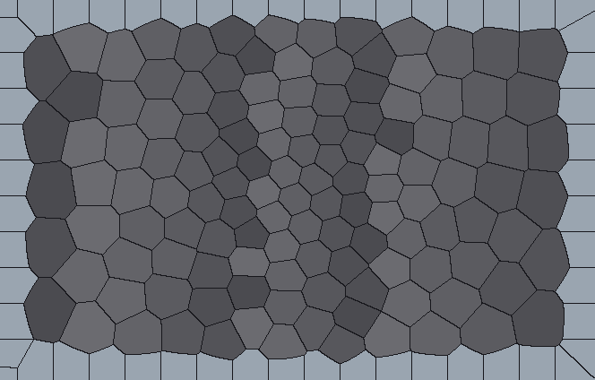
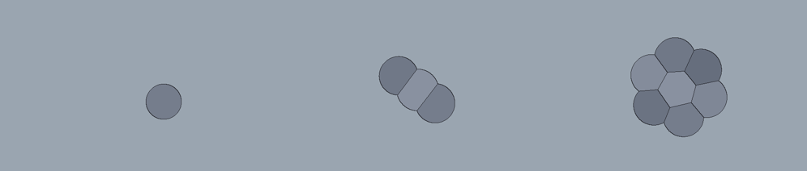
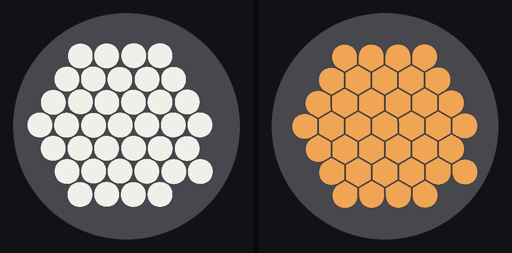
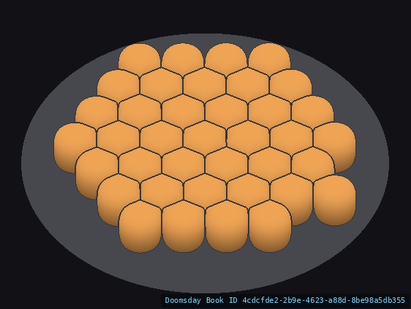

# Hex at the Root

### D, a physical mathematics in which everything is always something, and Delta, the language that models it

**Mike J Hebblethwaite**

*Working draft. Every number in this paper is a D numeral: digits 1 2 3 4 5 6 7 8 9 A B C D, counting from 1, with
no zero. Readers who need the outside world's numbers will find one bridge, at the very end.*

---

## Abstract

D is a mathematics of the physical world built on one rule: everything is always something. Nothing becomes zero
and nothing goes below what is there; things move (`>`) or break into parts (`D>`), and the parts not yet known are
written `~`. Energy that leaves a thing goes to its neighbours, and its amount always depends on its neighbours. What
cannot yet be traced goes to the Shrug, an area of waste where we have no clue yet where it went, investigated by
following the energy's path back.

From these rules comes a claim we set out to test: **hex is what equal neighbours make when energy moves evenly
between them**, and so hex lies at the root of things. We bring evidence from nature (molecules, ice, basalt columns,
the hexagon at Saturn's north pole) and from models written in Delta, a programming language built for D in which
zero and minus cannot be written. In Delta, a sheet of cooling lava given only the rule "share the pull evenly with
your neighbours" settles into hexagonal columns by itself; a circle built from tiny hex steps, with no sine or cosine,
stays within half a step of the true circle and measures 4√3 times its radius, with π deleted; and Faraday's first electric motor of
AA1 runs with every part of its energy accounted for in every frame.

---

## 1. D: always something

D (D for decompose, for destruction) is a maths of what physically happens. Its rules are few.

1. **Always something.** A thing never becomes nothing. What was called zero is "magic and make believe": the
   lowest temperature, for example, is not below anything; it is energy so low that we can no longer measure it,
   and it is written `~`.
2. **No negative numbers.** They are impossible. A number comes down only when something is moved out of it,
   and what moves out arrives somewhere.
3. **Move** `>`: a thing goes somewhere whole. `plum > Bob`.
4. **Decompose** `D>`: a thing breaks into its parts. `plum D> sugar + energy + heat + poo ~`. Every breakdown ends
   with `~`, the parts not known yet; a thing broken to its lowest point keeps only its unknown energy.
5. **Neighbours.** Spent energy goes to neighbours: stores absorb it, conductors pass it on less their heat, and the
   heat goes to their neighbours in turn. One less in a thing is one more in its lowest neighbour. Everything's amount
   depends on its neighbours.
6. **The Shrug** ¯\\\_(ツ)\_/¯. What goes somewhere not known yet goes to the Shrug: waste, an area where we have no
   clue yet where it went. It is investigated by following the energy's path back. An engineer aims for the smallest
   Shrug possible.

### 1.1 The numerals

D counts from 1 to D (thirteen digits) and has no zero digit. Ten is A, thirteen is D, the next number is 11. Each
digit is drawn with as many angles as the number it stands for, as a hex spiral: lines 1, 1, 2, 2, 3, 3 ... long,
turning a sixth of a turn at each corner. `~` has no angles: its count is not known yet. The old 0 key draws a circle
holding three dots, the unknown things left inside, like three ping pong balls. (Who chose each symbol, and why, is
kept in `HISTORY.md`; the stories behind them are in Appendix A.)

In the models below the numerals move: each number is drawn as turning spirals, coloured by the spectrum its energy
is in (heat from white-hot to deep red, electric current blue, chemical energy violet, motion green, the Shrug grey)
and shaded by how much there is.

## 2. The claim: hex at the root

Take many equal things on a flat surface and let them settle, each sharing evenly with whatever touches it. How many
neighbours can each have, all touching, all equal? Six. Ping pong balls laid flat settle six round one, every time
(ping pong balls as stand-ins for particles were Prof Eric Laithwaite's idea). Add a layer and it sits in the hollows
of the one below: the layers are hex, stacked.

**Claim.** Wherever energy moves evenly between equal neighbours, the arrangement it settles into is hex. Where it is
not hex, something is uneven, and that is where to look.

### 2.1 The claim, stated formally

Take a flat sheet divided into cells, where cells meet three at each corner (as cracks meet in cooling lava, and as
soap films meet). Let a sheet settle by D's rule: every place belongs to the nearest cell's centre, and each centre
moves toward the middle of its own share.

**Part one (proved): the average is six.** For any flat network, counting gives

    corners + cells = edges + 2

(the outside world writes it with a minus; it needs none). Every edge has two ends and, inside the sheet, three edges
meet at each corner, so twice the edges is three times the corners. Every edge borders two cells, so the
sides of all the cells together are twice the edges. Putting these together, the corners are two thirds of the
edges, so the cells are a third of the edges and 2 more, and the sides per cell are twice the edges shared among a
third of the edges and 2 cells: just under six, and closer to six the more cells there are. Fives and sevens must balance around six, as they do on the
Causeway and in every model sheet.

**Part two (proved in the outside world's mathematics): the even sheet is hexagonal.** Of all the ways to divide a
flat sheet into cells of equal area, the hexagonal one uses the least edge (the honeycomb conjecture, proved by Thomas
Hales in BAA). Equal neighbours sharing evenly have nowhere better to settle.

**Part three (shown, not proved): settling finds it.** From any repeatable start tried so far (5.3, 5.3a), D's rule
settles into a sheet where six-sided cells are the most common. A proof that it always does, from every start, is
open.

## 3. What nature shows

These are observations anyone can check.

- **Molecules.** Under an atomic force microscope a single pentacene molecule is five hexagonal rings of carbon, seen
  directly. Graphene, one atom thick, shows its carbon atoms in a hexagonal lattice under the electron microscope.
  Benzene, the ring at the heart of organic chemistry, is a hexagon.
- **Ice.** Each water molecule joins four neighbours, and frozen they lock into rings of six. That is why every
  snowflake has six arms. Water expands as it freezes by moving into those open rings; nothing vanishes.
- **Basalt.** At the Giant's Causeway, lava cooled and shrank, pulling evenly on its neighbours; the cracks met three
  at a time and the columns came out mostly six-sided, with some of five and seven where the cooling was uneven.
- **Saturn.** A hexagon of wind larger than the Earth has circled Saturn's north pole since the Voyager flybys of B94 and B95:
  a jet stream between slower air, its waves settling to six crests. (Jupiter's poles show rings of storms instead,
  eight round one in the north and five round one in the south: what packs there is not even, and that is the
  place to look.)
- **Bees.** A honeycomb is hex: the least wax for the most room.

## 4. Delta: a language in which zero and minus cannot be written

To test D's rules they must hold everywhere in the model, down to the machine. Delta is the C language with D's
rules, compiled straight to our own x86-64 assembly with no C compiler and no C library. Its compiler refuses:

- the digit 0 in any number or name, `NULL`, `false` and the zero character: *"zero apples? There are never zero
  apples. The seeds, water, sunlight and the nitrogen the fungi in the soil take up make the tree that gives the
  apples. Say what is there."*
- every minus: *"There are no negative numbers: it is impossible. Even the lowest temperature is not below anything:
  it is energy so low we can no longer measure it, ~."*

What it gives instead:

- numbers in D numerals; rows and arguments counted from 1; `return 1` for all good;
- `move N from a to b;`, which stops the program if `a` does not hold N; `less(a, b)`, a with b moved out;
  `apart(a, b)`, how far apart two numbers are; `towards(a, b, t, n)`, a moved t of n of the way to b;
- `D>`; `store`, `conduct`, `neighbours`, `spend`; heat that cascades to neighbours; leaks, wear, room, rupture and
  overflow; the Shrug (`shrug N from x;`), reported at the end of every run;
- a full-screen window of its own (it speaks X11 to the display itself) so that models can be seen.

The machine is always something too. A transistor does not switch between 1 and 0: it goes HIGH or LOW. A LOW is
lower than 1, still with current leaking and atoms with mass, carrying its `~`. Delta's own runtime calls it LOW.

Delta builds itself, all the way to the program file. Its compiler (`lang/dc.delta`) and its own assembler and
linker (`lang/da.delta`) are written in Delta; built by themselves, then by those copies, both come out the same byte
for byte. Nothing else is needed but Linux: every test and model in this paper is built by Delta alone.

A model written in Delta cannot cheat D: no quantity can vanish or go below what is there, because the language has
no way to say so, and every model keeps an energy book whose total is checked against its start every frame.

### 4.1 Hex inside, one bridge out

Inside D every place, step and turn is hex, down to the smallest step. Places are written (across, down) in doubled
steps; the six neighbours are 2 across, or 1 across and 1 down, each way; all six are the same distance away, and a
place's squared distance from the middle is a whole number, across² + 3 × down². A circle is the walk round a middle
through the neighbours that stay nearest one distance. There is no sine, no cosine and no fraction of a turn.

The outside world is square: screen pixels, memory addresses, other people's sines and cosines. Compatibility goes
through one bridge at the smallest point and nowhere else. In the models the bridge turns hex down steps into square
units with 1D/12 for √3, off by about 1 part in 7CC.

### 4.2 The bridge's error, and the book

**The bridge.** Turning hex steps into square units needs root 3; the models use 1D/12 (26/15 in outside numbers).
Squared, 1D/12 gives 3CC and 1 over 144 (676 over 225), where root 3 squared would be 3CC over 144 (675 over 225).
So every length that crosses the bridge comes out 1 part in about 7CB (1,350) too long, whatever its size: a circle
of radius R hex steps lands R/7CB square units further out than true, and the whole numbers it rounds to are within
one more unit. It is the same share at every radius, so a picture is never bent, only very slightly enlarged.

**The book never crosses the bridge.** The bridge is used only to place things on the square screen (where a wire is
drawn, which way a spiral turns). Every amount in every model's energy book moves in whole units, by `move`, `D>`
and the flow words, and never passes through root 3. Its effect on the books is none.

**The book, written out.** Every model keeps one balance, checked every frame:

    what it started with = what each part holds + what the neighbours took (air, floor, room)
                           + the Shrug (waste: gone where we have not traced yet)
                           + ~ (unknown energy left inside things broken down)

Every term is always something (or LOW, never below it), and nothing is ever taken away: an amount only moves from
one term to another. The Shrug is a term like any other, so the book is fully algebraic: tracing the waste back along
its paths (a later step) moves amounts out of the Shrug into named parts, and the balance still holds.

## 5. Models

Each model is a Delta program in `lang/examples/`; each runs with `lang/delta run <file>`.

### 5.1 A circle made of tiny hex connections (`hexring.delta`)

A circle of radius $C17 hex steps, walked round with whole numbers only:

| measured | |
|---|---|
| steps round | 65C6 |
| furthest from the true circle | 7 sixteenths of a step |

The walk never strays half a step from the true circle. Its length, 65C6 steps for a radius of C17, is 4√3 times the
radius to within one step: measured in hex steps, a circle's length is 4√3 R. π is deleted: a circle is counted
in hex steps, not measured against a turn. (Why it comes to
4√3 is to be written out in the next draft.)

### 5.2 Formulas with π deleted (`formulas.delta`)

The outside world measures a circle against a turn, and π appears: a circle's length 2πr, its area πr², a ball's
skin 4πr², a ball (4/3)πr³. In D a circle is made of tiny hex connections, so it is counted:

| outside, with π | D, counted in hex steps | |
|---|---|---|
| circle's length 2πr | the ring: every place R steps from the middle | **6R** places |
| circle's area πr² | the disc: every place up to R steps | **3R(R + 1) + 1** places |
| ball's skin 4πr² | the shell: equal balls packed close, R steps out | **AR² + 2** balls |
| ball (4/3)πr³ | the ball: every close-packed ball up to R steps | **(2R + 1)(5R² + 5R + 3) / 3** balls |

Whole numbers: no π, no root, no fraction of a turn. The close packing is hex layers stacked in each other's hollows,
each ball touching C others. The Delta program walks the hex grid and the close packing and counts every place for R
from 1 to 9: every count equals its formula.

| R | ring | disc | shell | ball |
|---|---|---|---|---|
| 1 | 6 | 7 | C | D |
| 2 | C | 16 | 33 | 43 |
| 3 | 15 | 2B | 71 | B4 |
| 4 | 1B | 49 | C6 | 1AA |
| 5 | 24 | 6D | 165 | 342 |
| 6 | 2A | 9A | 21B | 55D |
| 7 | 33 | CD | 2BB | 84B |
| 8 | 39 | 139 | 3A5 | C23 |
| 9 | 42 | 17B | 4A6 | 13C9 |

A round circle can also be walked in tiny hex steps (5.1): its length is then 4√3 R steps. π only appears at the
bridge, when someone outside asks for the answer in their square units and radians.

### 5.3 The Giant's Causeway (`causeway.delta`)

A sheet of lava is given 219 crack centres at a repeatable scatter (not real random: no seed from the world yet) and
one rule: every column shares its pull evenly with its neighbours, so each centre moves half way toward the middle
of its own share, each step. Cracks lie where two shares meet. No hexagon is drawn anywhere in the program. The sides
of every column away from the border are counted as it goes.

Counted as it ran (columns away from the border; steps after the cracks first open):

| step | five sides | six sides | seven sides | other |
|---|---|---|---|---|
| 2D | 44 | D4 | 44 | 2 |
| 5C | 42 | 115 | 37 | ~ |
| 8B | 31 | 133 | 2A | ~ |
| BA | 2B | 13A | 26 | ~ |
| 119 and on | 29 | 13B | 27 | ~ |

From a scatter, the sheet settles in about 119 steps and then holds: 13B of its 191 columns are six-sided (three
in every four), and the rest are fives and sevens in nearly equal numbers, so the columns still average six sides.
That is how the real Causeway looks: mostly hexagons, with five- and seven-sided columns where the cooling was
uneven.

The heat moves from the lava to the air and the ground, and through the border into the Shrug; the book's total
equals its start at every step.

### 5.3a Looking for a counter-example (`causeway-search.delta`)

The review asked whether the Causeway's rule settles into hexagons from any start, not just one. The search runs the
same rule on 4B sheets: three sizes (A1 by 69, 15A by C6, 1D2 by 145 half-pixels), three numbers of columns (4C, 93,
125) and seven repeatable starting scatters (column i starts at i x A mod the width, i x B / 7 mod the height, for the
seven pairs A, B written in the program). Each sheet settles for 11B steps; then the sides of every column away from
the border are counted.

In every one of the 4B sheets, six-sided columns are the most common. Their share runs from 36 to 68 in every 79
(79 is a hundred). The lowest shares come from the sheets packed with the most columns into the fewest half-pixels,
where each column is only a few pixels across and its edges are rough. No counter-example was found.

The Causeway sheet in 5.3 is reproducible too: column i starts at (i x 37B2 mod 13 x the sheet's width, i x 38891 / 7
mod 13 x its height), in sixteenths of a half-pixel, on a sheet half the size of a B49 by 651 screen.

### 5.3b The same rule in three dimensions (`cells3d.delta`)

The review asked for the "share evenly" run in a block of space. Cells start at a repeatable scatter in a cube of 31
by 31 by 31 places that wraps round at its edges (so no cell touches a wall). Each step, every place belongs to the
nearest centre, and each centre moves half way toward the middle of its share; after 3B steps, every cell's
neighbours (the cells it touches across a face) are counted.

| cells | neighbours per cell: how many cells | most common |
|---|---|---|
| 42 | A:1 B:2 C:6 D:D 11:12 12:8 13:6 14:3 | 11 |
| 84 | B:3 C:5 D:1A 11:2B 12:22 13:A 14:2 | 11 |
| 9B | C:8 D:24 11:3B 12:1D 13:C 14:2 | 11 |
| 99 | B:1 C:A D:24 11:2D 12:26 13:D 14:1 | 11 |

In every cube the most common cell touches 11 (fourteen) neighbours, not C (twelve). The spread is still wide, so the
cubes are not fully settled at this size, but every run leans the same way. In three dimensions, D's sharing rule
settles toward the truncated octahedron (eight hexagonal faces and six square ones), not toward close packing.

This is a result against the simplest form of the claim, and it is reported as such. In a flat sheet two questions
give the same answer: how equal balls pack, and how equal shares divide the space. In three dimensions they part:
equal balls pack in hex layers with twelve neighbours each, while equal shares settle with fourteen.

### 5.3c Neighbour-dependent edges (`edge.delta`)

Under the microscope, the outer rings of a molecule curve where the atmosphere is their neighbour. In D an edge
between two cells is where their pulls balance: equal neighbours balance on a straight line, unequal ones on a curve.
The model settles 9B lava columns with the air all round them; the only difference is that the air pulls a little
more strongly (each place's nearness to the air counts 4 to every 3 for lava). Nothing curved is drawn.

Inside, column meets column on straight edges, mostly six-sided. At the outside, every column's edge against the air
is curved. Everything's shape depends on its neighbours.

### 5.3d Bubbles: neighbours make the shape of everything (`bubbles.delta`)

A soap bubble alone is round; a cluster has flat walls inside and curved walls outside, and a bubble with bubbles all
round it is a hexagon. In the model each bubble holds a fixed amount of gas. Its neighbours are the gas inside,
pushing out equally every way; the air outside; the bubbles beside it; and the soap film, drawing them together. A
squeezed bubble pushes harder and reaches further; one with room eases off; walls sit where pushes balance. Nothing
round, straight or six-sided is drawn.

One bubble settles into a circle: only the air is its neighbour. Three settle into a chain: straight walls between
bubbles, curved walls against the air. Seven settle six round one: the middle bubble, the only one with bubbles on
every side, is a hexagon; the six round it are curved where the air is their neighbour. Everything's shape depends on
its neighbours: equal neighbours on every side make hex.

### 5.3e Bubbles in three dimensions, with an outside (`bubbles3d.delta`)

The same bubble rule in a block of space 31 places each way, with air all round instead of a cube that wraps. After
1C9 steps:

| bubbles | what settles |
|---|---|
| 1 | a ball: B places across, B deep, B high, holding 499 places of gas (497 asked) |
| 7 | the middle bubble touches 6 others |
| D | the middle bubble touches C others: one with twelve round it, the close-packing count |
| 16 | the middle bubble touches D others |

A lone bubble is a ball, the same every way, with nothing round drawn. And with a real outside, the middle of a
cluster of D settles touching C, where the endless wrapped cube of 5.3b settled at 11. Neighbours make the shape: an
outside changes the answer. Twelve neighbours alone does not prove hex layers (twelve can also sit in other
arrangements); which arrangement the twelve take is the next thing to measure.

### 5.4 Faraday's electro-magnetic rotations, AA1 (`faraday.delta`)

The first electric motor, as Michael Faraday set it out: two glasses of mercury, a voltaic pile, a brass stand. In the
left glass a hanging copper wire goes round a fixed magnet; in the right glass a magnet tied at its foot goes round a
fixed copper rod. The pile's energy is shared by resistance (a rough guide: pile 17A, wires 48, mercury 4A, magnets 2,
the two turns 6, of every 24A); heat rises from the pile, the wires and the mercury into the air, the floor, the
walls, and out through the border into the Shrug. Every value is shown, and the total equals the start every frame.

### 5.5 Today's simple motor in a room (`world.delta`)

A battery of one and a half volts on a magnet, a copper wire touching both: today's toy on Faraday's principle, drawn at real size
in a room 17 feet each way, with the same book.

### 5.6 A cake cut into three (`cake.delta`)

The outside world says 1 / 3 = 0.3333... for ever. No cake has ever done that. A cake is a whole number of crumbs
(and the crumbs of molecules). Cut into three, each plate takes its share of whole crumbs; the one or two that do not
share evenly stay on the knife, the cake's neighbour.

| the cake | plate one | plate two | plate three | on the knife | all together |
|---|---|---|---|---|---|
| 9999 crumbs | 3333 | 3333 | 3333 | nothing | 9999 |
| 999A crumbs | 3333 | 3333 | 3333 | 1 | 999A |
| 999B crumbs | 3333 | 3333 | 3333 | 2 | 999B |

The endless 3s belong to the writing, not to the cake. D does not write a fraction of a whole: it counts the parts and
moves them, and every part arrives somewhere: on a plate, or on the knife.

### 5.7 The challenge

The author's challenge to any peer who wants to disprove D: give one example, anywhere in the known universe, where
there is nothing. D cannot have a zero, because a zero is not possible. (Even the emptiest vacuum yet measured is not
empty: it holds energy, fields and radiation, and particles appear and vanish in it.)

### 5.8 Ping pong balls, heat and a Henry: the raft (`lang/lab/runs/pingfunnel.delta`)

The author's dream, told before any run: ping pong balls, warm and pliable, pulled together by air flowing out through
the gaps where three meet, go hex. The lab built it as a cone tray (2 degrees) of fine-holed plate (holes A mm apart)
with a Henry vacuum pulling under it and hot air from above at 93 C. 2C balls were set by hand in hex, as on the bench.
Cold, the suction only locks them; warm (see the warmth window below), each
wall flattens against its neighbour as the flow pulls it into the gaps, and the raft closes: every inside ball a
hexagon, the edge balls flat where they touch and round where the air is their neighbour.

**Warmth window** (81 to 98 C all close the raft, none melting; 9D C melts every ball): on the bench anywhere in that
window works; past it the plastic drips.

**Hole size and Henry power.** The time (seconds) until every wall in the raft is flat, and the Henry's pull under the
plate, for each size of plate hole and each Henry power (1A1 s run, 93 C):

| plate holes (tenths of a mm across) | Henry power 3 | power 6 | power 9 | power B |
|---|---|---|---|---|
| 3 | 14C s (2415 Pa) | A4 s (4669 Pa) | 79 s (67B2 Pa) | 69 s (7C84 Pa) |
| 4 | 158 s (22B8 Pa) | AA s (432D Pa) | 81 s (61BA Pa) | 71 s (7497 Pa) |
| 5 | 169 s (213D Pa) | B7 s (3BC8 Pa) | 89 s (5769 Pa) | 79 s (67BB Pa) |
| 7 | 199 s (1A3D Pa) | DC s (322C Pa) | AB s (43C5 Pa) | 9A s (4C8D Pa) |
| A | not all in 1A1 s (1355 Pa) | 17B s (1DB4 Pa) | 141 s (2753 Pa) | 129 s (2AC2 Pa) |

A stronger Henry closes the raft sooner at every hole size. Finer holes hold more suction (the plate leaks less) and
close it sooner; at 1 mm holes the weakest Henry never closes it in 1A1 s. Bench recipe: the finest holes the plate
allows, the Henry at full power, about 93 C: 69 s (power B, holes 3 tenths).

**What is put in, said plainly.** The hand-set hex start, and the flattening rule (how fast a warm wall flattens under
the pull) is the lab's own choice, marked as magic. In these runs one flatness number is kept per ball and the
pictures draw its faces half way to each neighbour, so the hexagons in the pictures follow from the hex start.
**Checked blind since (section 7): with a wall rule written from celluloid's own physics, the hand-set raft keeps its hex
but its walls flatten only 12% (sealed balls) to 38% (vented), none fully flat in 5 minutes at 93 C. So the warmth window
and the times in the table above come from the lab's own flattening rule (magic), not from the material: the raft sealing
is not shown.**

## 6. Measuring without negatives

The outside world's scales go below zero in many places. D cannot, because a negative amount is impossible. Each
everyday negative turns out to be one of four things: a direction, a difference, an owner, or a distance still to go.

**Amounts move; readings are replaced.** A scientist says a blob holds 0.2 of unknown energy; later it is found to hold
3. Nothing was taken away: the energy was always there, and more of its `~` got a name. D keeps the two apart. An
amount (what physically is) only moves. A reading (what has been measured so far) is replaced by a better reading.
And 0.2 is not a fraction in D: it means "count in smaller units", as a cake is counted in crumbs.

**What it needs to be 1.** Where the old world writes a negative energy, D says how much it needs to reach its next
whole step. An electron held in a hydrogen atom is written in physics as having negative energy. In D it is bound: it
needs 6262 thousandths of an electron-volt to be free. The amount it needs is always something.

| the outside world writes | D says |
|---|---|
| temperatures below zero (Celsius, Fahrenheit) | count up from the lowest point, energy so low it can no longer be measured (`~`). Cold is little energy, never negative energy. Kelvin comes close but still names that point 0; D's scale starts at 1 just above it. |
| negative charge | two kinds of charge, both something, each named (the electron's and the proton's), never signed |
| negative voltage | a difference between two places: always a distance apart, and which way it pushes |
| negative potential energy (gravity, a bound electron) | bound: the energy it needs to be free |
| below sea level | depth, counted down from the surface: a distance |
| moving backwards, negative speed | a speed and a direction |
| a debt, a negative balance | moved: it is on the lender's side of the book |
| before an event, negative time | before: a direction in time, counted from the event |
| a tachyon (a particle needing its mass squared below zero) | a myth until it is seen: no detector has ever found one |

Every row is the same move: the minus sign was carrying a direction, an owner or a distance still to go. D writes
that down by name, and the amount itself is always something.

## 7. What is shown, and what is not yet

- The raft (5.8), checked blind (proofs/blind-wall-2026-11-21, every plan stamped before its runs): a fresh helper, never told
  the dream, wrote the wall rule from celluloid alone. Scattered balls did NOT go hex from heat and suction (sealed and
  vented: FAIL). Shaking the tray (Mike: his hand on his rig) packed scattered balls hex in single runs (0.91-0.93), but
  repeated five times each it did not hold (shaken mean 0.762, still 0.780): shaking does not reliably pack them hex in the lab. Hand-set
  in hex, the real-material walls flatten 12-38%, none fully: the raft does not seal in the lab's 5 minutes. Packing and
  sealing are two steps; the sealing is still to be shown.
- The models are demonstrations by model, not proofs. They show that D's rules, kept exactly, produce hex where
  neighbours share evenly. A proof in D's own terms is the next step.
- In three dimensions equal balls pack in hex layers stacked in the hollows (twelve neighbours), but D's own sharing
  rule settles toward fourteen neighbours (5.3b). The flat claim holds; the three-dimensional one must be stated as two
  questions, packing and sharing, with different answers.
- Five-fold things exist (Jupiter's south pole, some crystals). In D's terms they mark uneven sharing, and they are
  where to look next.
- The causeway's crack centres start from a repeatable scatter. A seed from the world (sand in the air) is planned.

## 8. To run the models

    lang/delta run lang/examples/hexring.delta
    lang/delta run lang/examples/formulas.delta
    lang/delta run lang/examples/causeway.delta
    lang/delta run lang/examples/faraday.delta
    lang/delta run lang/examples/world.delta
    lang/tests/run.sh

The code is at github.com/mikehebblethwaite-hub/d-math.

## Acknowledgements

Prof Eric Laithwaite, for ping pong balls as particles. The code was written with Claude, an AI model made by
Anthropic.

---

## Appendix A: Stories

As a child the author drew three spirals in a circle again and again; his great-grandfather told him it was a carving.
The triple spiral is cut in stone at Newgrange, older than Stonehenge. On the day these models were made, D's numerals,
drawn as spirals that move and change colour with their energy, showed it again: "the three spirals in a circle then
just showed up as language for everything moving." The author's family has kept knowledge by word of mouth for
generations, and treats it as a source.

## The bridge (for readers of the outside world's numbers)

| D | outside |
|---|---|
| 2 | 2 |
| 7 | 7 |
| A | 10 |
| D | 13 |
| 11 | 14 |
| 17 | 20 |
| 1D/12 | 26/15 (the √3 bridge) |
| 24A | 400 |
| 17A | 270 |
| 48 | 60 |
| 4A | 62 |
| 219 | 360 |
| AA1 | 1821 |
| B94 | 1980 |
| B95 | 1981 |
| 7CC | 1351 |
| 191 | 287 |
| 13B | 219 |
| 29 | 35 |
| 27 | 33 |
| 6262 | 13600 |
| 4B | 63 |
| B49, 651 | 1920, 1080 |
| 36, 68 | 45, 86 |
| BAA | 1999 |
| 31 | 40 |
| 3B | 50 |
| 42, 84, 9B, 99 | 54, 108, 128, 126 |
| C, 11 | 12, 14 |
| 9B | 128 |
| 1D/12 | 26/15 |
| 3CC and 1, 3CC, 144 | 676, 675, 225 |
| 7CB | 1350 |
| 1C9 | 334 |
| 497, 499 | 800, 802 |
| 16 | 19 |
| 9999 | 21420 |
| 3333 | 7140 |
| C17 | 2048 |
| 65C6 | 14189 |
